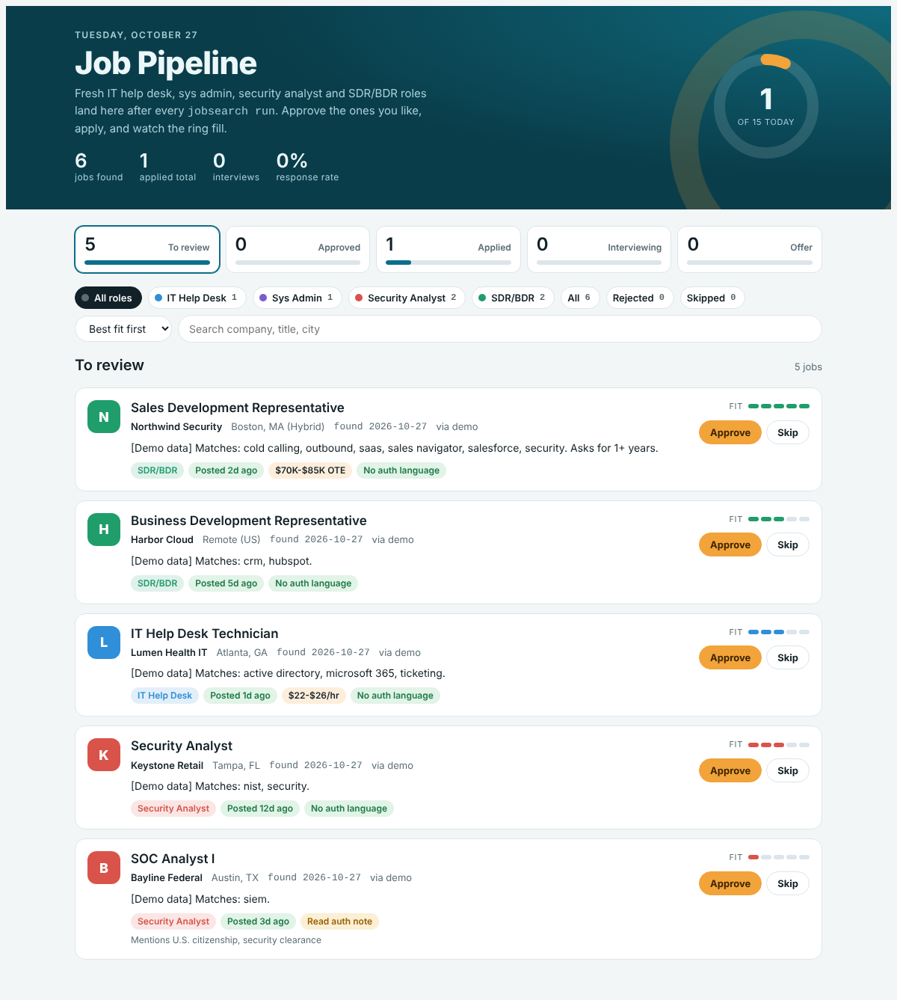
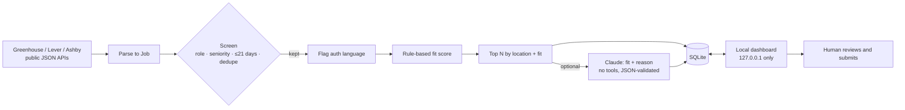

# AI Job Search Automation

A human-in-the-loop job search pipeline. It pulls fresh postings from public applicant-tracking-system APIs, screens them for role, seniority, freshness and work-authorization language, scores each one against a candidate profile (rules, plus Claude when an API key is set), and tracks every application on a local dashboard.

**The automation stops before submit.** It finds, filters, ranks and tracks jobs. The candidate reviews and submits every application, which keeps answers to legal questions (work authorization, sponsorship) accurate and respects job boards' terms of service.



*The dashboard running on the built-in demo data (fictional companies).*

## What it does

| Stage | How |
|---|---|
| **Collect** | Reads the public JSON job-board APIs of Greenhouse, Lever and Ashby for a watchlist of companies. No scraping, logins or CAPTCHAs. Requests are rate-limited. |
| **Screen** | Classifies titles into four target tracks (IT Help Desk, Sys Admin, Security Analyst, SDR/BDR), drops senior roles, drops postings older than 21 days (undated postings fail closed), and de-duplicates against everything already tracked. |
| **Flag** | Detects citizenship, security clearance, "no sponsorship" and ITAR/export-control language with tested regex rules. Flagged jobs are kept and labelled by default, or dropped if configured. |
| **Score** | Gives a 1–5 fit score from skill overlap and required years of experience. With `ANTHROPIC_API_KEY` set, Claude re-scores the top candidates and writes a one-line reason. |
| **Cap** | Keeps at most `daily_cap` new jobs per run (default 15), preferred locations first. |
| **Track** | Stores everything in SQLite. The local dashboard moves each job through To review → Approved → Applied → Interviewing → Offer, and shows progress toward the daily goal. |

## Quick start

```bash
git clone https://github.com/<your-username>/ai-job-search-automation.git
cd ai-job-search-automation
python -m venv .venv && source .venv/bin/activate
pip install -e ".[dev]"

jobsearch demo          # offline demo with fictional jobs → http://127.0.0.1:8765
```

Run it for real:

```bash
cp config.example.toml config.toml   # set your profile, skills, locations and company watchlist
pip install -e ".[llm]"              # optional: Claude scoring
export ANTHROPIC_API_KEY=...         # optional

jobsearch run           # fetch, screen, score and store new postings
jobsearch serve         # open the dashboard
jobsearch list          # or use the terminal
jobsearch status <job-id> applied
```

Schedule `jobsearch run` daily with cron, Windows Task Scheduler or a scheduled GitHub Action.

## Architecture



More detail is in [docs/architecture.md](docs/architecture.md).

## Security design

This project treats job postings as **untrusted input** and is designed so that a malicious posting can, at worst, produce a wrong score:

- **Prompt-injection containment.** The LLM gets no tools and no ability to act. Posting text is wrapped in delimiters and labelled as data, and the reply must parse as a two-field JSON object with bounded values, or it is thrown away.
- **Human-in-the-loop.** Nothing is ever submitted automatically.
- **Least exposure.** The dashboard binds to `127.0.0.1`, validates status values against an allowlist, constrains IDs by regex, caps request bodies, and sends `nosniff` and Content-Security-Policy headers.
- **Secrets.** The API key is read from the environment only. `config.toml` and the database are git-ignored.
- **Fail closed.** A posting without a date counts as stale, and one bad job board doesn't stop the run.

Full threat model: [docs/security.md](docs/security.md).

## Project layout

```
src/jobsearch/
  sources/       greenhouse.py, lever.py, ashby.py  (pure parse + fetch)
  screening.py   role, seniority, freshness, location, auth-language rules
  scoring.py     rule-based fit score
  llm.py         optional Claude enrichment with output validation
  pipeline.py    orchestration and daily cap
  storage.py     SQLite store
  server.py      local dashboard server
  dashboard/     single-file dashboard UI
tests/           39 unit tests (parsers, screening rules, scoring, storage, LLM output validation)
```

## Tech stack

Python 3.11+ (standard library only for the core) · SQLite · vanilla JS dashboard · Anthropic Claude API (optional) · pytest · Ruff · GitHub Actions CI

## Roadmap

- Resume and cover-letter tailoring for approved jobs
- Follow-up reminders 7–10 days after applying
- More sources (Workable, SmartRecruiters)
- Email digest of each run

## License

MIT
